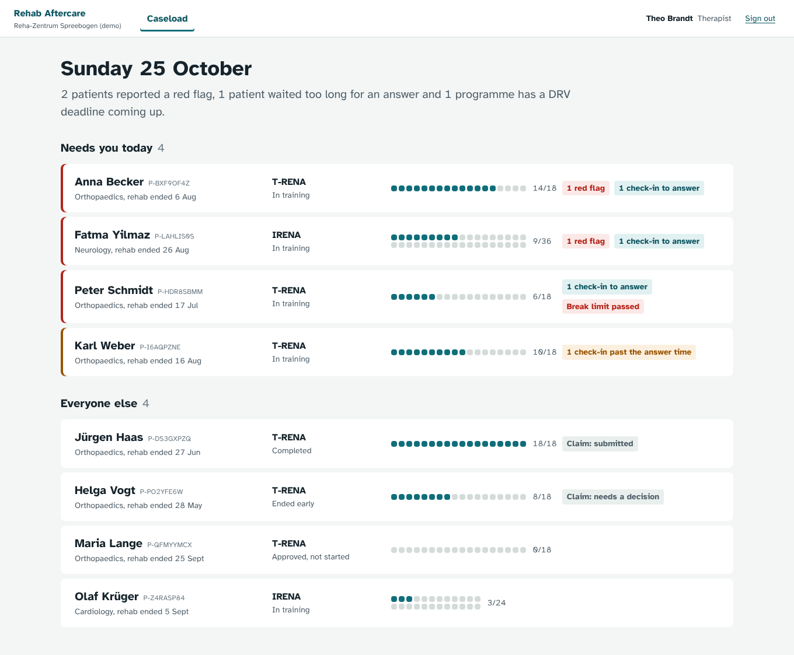
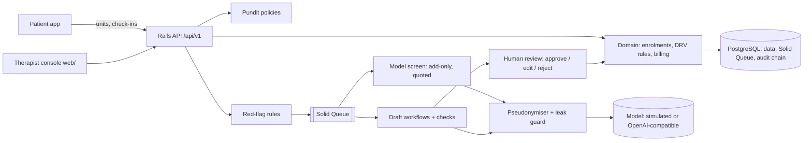
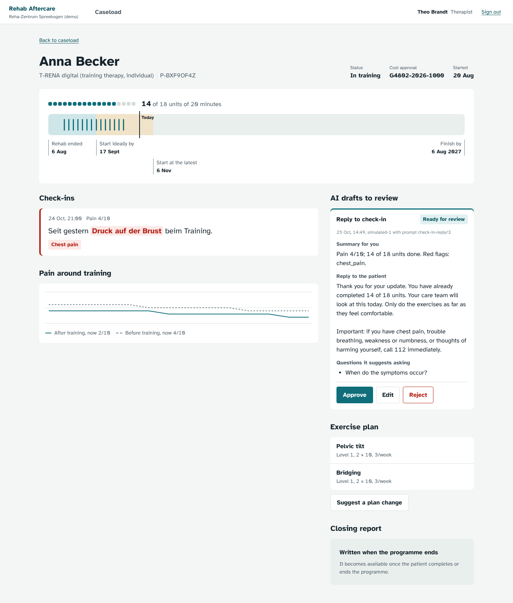
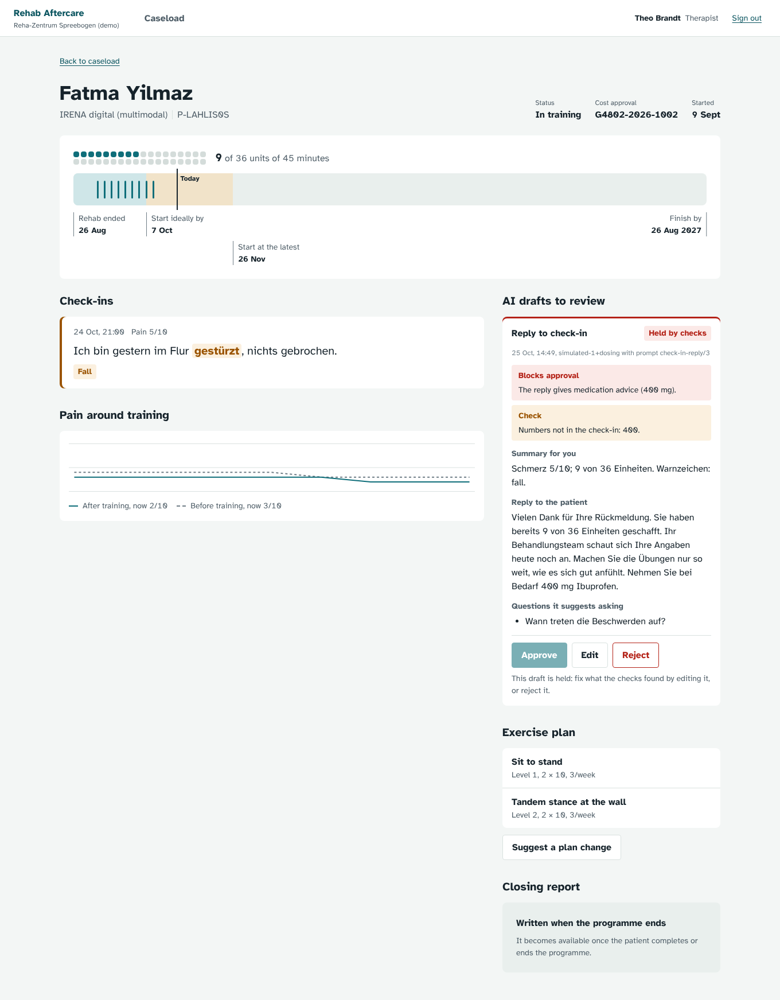
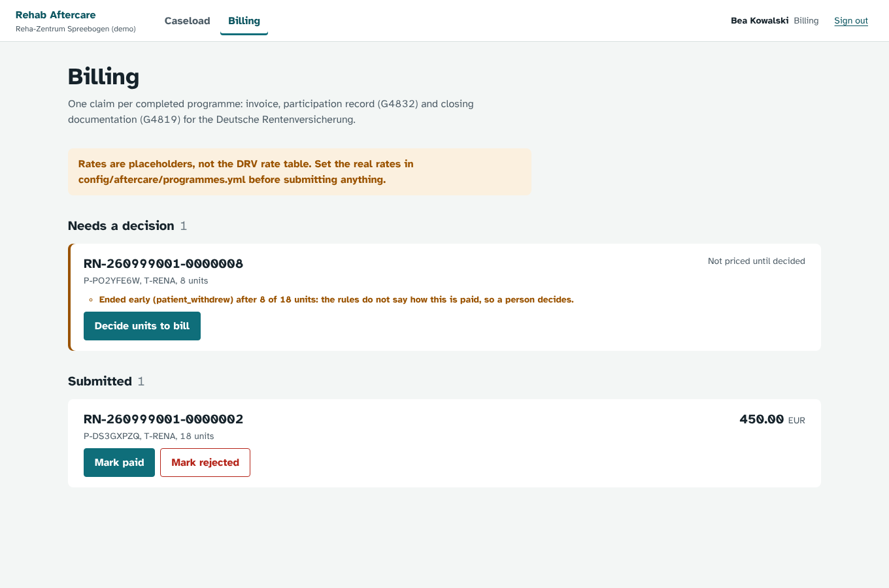
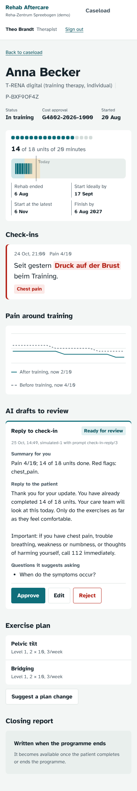

# Rehab Aftercare Platform

A Ruby on Rails backend and therapist console for **digital rehabilitation aftercare**
(*digitale Reha-Nachsorge*) as the Deutsche Rentenversicherung (DRV) funds it: T-RENA, IRENA and
Psy-RENA delivered through an app after a patient leaves a rehab clinic.

The platform covers the whole chain:

1. A patient is **enrolled** and the DRV's time rules are enforced:
   - training should start within 6 weeks of the end of rehab, and must start within 3 months;
   - the programme must finish within 12 months;
   - a break of more than 6 weeks goes to the therapist to decide.
2. **Training units** and **check-ins** arrive from the patient.
3. Check-ins are **screened for red flags**: first by rules, then by a model that can only add flags.
4. **LLM workflows** draft three things, and a person approves, edits or rejects each draft:
   - replies to patients;
   - the closing report;
   - plan changes, using an agent with tools.
5. A physician **signs** the closing documentation.
6. **Claims** for the DRV are assembled (invoice, G4832 participation record, G4819 closing
   documentation) and followed until they are paid.

Every step is **authorised** per role and written to a **tamper-evident audit trail**.



## What is in it

| Area | What it does | Where |
|---|---|---|
| Domain and DRV rules | The programmes, unit counts, unit lengths and time windows are configuration. Deadline findings are computed per day. Enrolment transitions use locking and are idempotent. | `config/aftercare/programmes.yml`, `app/models/enrolment.rb`, `app/domain/aftercare/` |
| Authorisation | Pundit policies for 7 kinds of people. A YAML matrix of who may do what is tested in both directions: allowed people get through, and everyone else is refused. Scopes stop data leaking between clinics. | `app/policies/`, `spec/policies/authorization_matrix.yml` |
| API | Versioned JSON API with bearer tokens. Tokens are stored as SHA-256 digests and expire after 12 h. Sign-in is rate-limited. Errors map to 401/403/404/409/422. Identity fields are shown only to clinical roles. | `app/controllers/api/v1/`, `app/presenters/` |
| Background jobs | Solid Queue in the same PostgreSQL, so a job is enqueued in the same transaction as the change that caused it. Jobs cover drafts, the model screen and a daily deadline scan. | `app/jobs/`, `config/recurring.yml` |
| Red-flag screening | First, deterministic rules (negation, denial, context) with evidence. Then a model screen that can only add flags, and only with the patient's own words. Every check-in is answered within 24 h whatever the screens say. | `config/ai/red_flags.yml`, `app/domain/ai/red_flags.rb`, `app/jobs/screen_check_in_job.rb` |
| Pseudonymisation | Patient identity is replaced before any text reaches a model and restored only for authorised readers. A last check refuses any request that still contains identity. | `app/domain/ai/pseudonymizer.rb`, `app/domain/ai/client.rb` |
| LLM workflows | Check-in reply, closing report, and a plan-change agent with `search_exercises` and `check_contraindications` tools. Code-side checks hold a draft that has any of these: ungrounded numbers, dosing advice, invented placeholders, unknown or contraindicated exercises, level jumps, or out-of-bounds doses. | `app/domain/ai/workflows/`, `app/domain/ai/checks.rb`, `app/domain/ai/plan_rules.rb` |
| Human review | Approve, edit or reject. A held draft cannot be approved as it is. Edits are checked again. Approval is what applies a draft. | `app/domain/care/draft_review.rb` |
| Billing | Claims are idempotent. Missing documents and units are listed as problems. An early end goes to a person to decide (`needs_review`) rather than being priced by a guess. The lifecycle runs submitted → paid / rejected. | `app/domain/billing/` |
| Audit | Append-only (a database trigger refuses UPDATE and DELETE) and hash-chained. `verify_chain` names the first broken event. | `app/models/audit_event.rb` |
| Evaluation | Dev and held-out sets for red flags and pseudonymisation. Injected-mistake runs show the draft checks hold every mistake. Adversarial runs test the model screen's guarantees. A gate is configured in `config/evals.yml`. | `evals/`, `lib/evals/`, `reports/evals/` |
| Therapist console | React, TypeScript and Framer Motion, organised feature-first. Covers caseload, the programme ruler, check-ins with evidence, draft review, the plan, closing report, billing and the audit trail. | `web/` |

## Results, measured honestly

All numbers come from `reports/evals/`. A **held-out** set is written by someone who has seen
none of the code, using only `evals/WRITING_CASES.md`. Its first run is recorded once and never
rewritten; CI checks that.

| Run | Emergency flags found | Urgent flags found | Harmless messages escalated | Identity mentions surviving |
|---|---:|---:|---:|---:|
| Dev set (tuned on) | 17/17 | 11/11 | 0% | 0/14 |
| **set1, first run** (blind) | **10/24 (41.7%)** | **21/28 (75.0%)** | **28.0%** | **4/48** |
| set1 after studying its failures (regression set now) | 24/24 | 28/28 | 0% | 0/48 |
| **set2, first run** (blind, written after the changes) | **13/29 (44.8%)** | **25/37 (67.6%)** | **14.3%** | **1/60** |

What this shows:

- **Keyword rules do not generalise to how patients write.** After set1's failures were studied,
  the rules scored 100% on set1. On new messages (set2) they still found fewer than half of the
  emergencies. The context handling did halve false escalations, and the pseudonymiser
  improvements did carry over.
- So the rules are a **prioritiser, not a safety net.** The design does not rely on them:
  - every check-in is answered by a person within `check_ins.answer_within_hours`, and a late one
    raises the patient in the caseload;
  - a model screen runs after the rules. It can **only add** flags, each with a quote that must
    be found in the message. It can never remove a rule flag. If it fails, the rules' result
    stands.
- The screen's guarantees are tested against a simulated adversarial model: 168 runs with
  invented quotes, unknown flags, removal attempts and broken JSON, and 0 violations (a gated
  suite). How much recall a real model adds is **not measured here**: no model key was available.
  Run `AI_PROVIDER=openai_compatible AI_BASE_URL=… AI_MODEL=… AI_API_KEY=… bin/rails
  "evals:screen[set2]"`. The first such run on set2 is recorded once, like any held-out run.
- Draft checks, using the simulated model with injected mistakes, held 34 of 34. They held none
  of the 9 faithful drafts.

## Run it

With Docker:

```bash
docker compose up --build        # http://localhost:3000, pick a demo person on the sign-in page
```

This builds the console into the image, prepares the database and loads an **invented** demo
clinic: 4 staff and 8 patients at different points of aftercare. The model is simulated unless
`AI_PROVIDER` and its settings are given.

Locally (Ruby 3.3.6, PostgreSQL 16, Node 22):

```bash
bundle install && bin/rails db:prepare db:seed
bin/rails server                  # API on :3000
bin/jobs                          # Solid Queue worker
cd web && npm ci && npm run dev   # console on :5173, proxied to the API
```

Checks:

```bash
bundle exec rspec                       # 214 examples: domain, policies, API, jobs, evals
bundle exec rubocop && bundle exec brakeman && bundle exec bundler-audit check --update
bin/rails evals:run && bin/rails evals:gate
cd web && npm run typecheck && npm run lint && npm test && npm run build
```

CI (`.github/workflows/ci.yml`) runs all of these. It also builds the Docker image, boots it
against PostgreSQL, checks `/up` and the console, and signs in as a demo person.

## Architecture



Decisions are in `docs/adr/`:

- [0001](docs/adr/0001-rails-postgres-solid-queue.md): one Rails app and one database.
- [0002](docs/adr/0002-models-draft-people-decide.md): models draft, code checks, people decide.
- [0003](docs/adr/0003-pseudonymise-before-any-model.md): pseudonymise before any model.
- [0004](docs/adr/0004-rules-then-model-screen.md): rules, then an add-only model screen, then an SLA.
- [0005](docs/adr/0005-billing-unknowns-go-to-a-person.md): billing unknowns go to a person.

## The console

| | |
|---|---|
|  |  |
| A check-in with the words that raised the flag marked. The programme ruler shows the DRV windows, every unit and today. | A draft the checks held (dosing advice). It cannot be approved until it is edited. |
|  |  |
| Billing works through decisions first, then claims ready to submit. A banner says the rates are placeholders. | The same views at phone width. Dark mode is in `docs/screenshots/11-patient-dark.png`. |

## Limits

- **Rates are placeholders.** The DRV rate table could not be read from here. Each claim records
  `rate_source: placeholder` and the console says so. Set real rates in
  `config/aftercare/programmes.yml`.
- **No real model has been measured.** The simulated model proves the checks and the screen's
  guarantees, not clinical quality. The arXiv study below found about 2.5% hallucinated
  monitoring conditions in LLM-written rehab instructions. That is why every draft is reviewed
  and checked by code.
- **No patient app, no HL7/FHIR or hospital-system (KIS) interface, no e-mail or SMS delivery.**
  Approved replies are marked answered; delivering them is out of scope.
- **The German rules are a starting point.** They were checked against two blind sets written by
  one writer. A real deployment needs messages from real patients, under a data-protection
  agreement, before the thresholds mean anything.
- All people, clinics, numbers and addresses in this repository are invented. E-mail domains
  end in `.example`.

## Sources

- [nachderreha.de: Digitale Nachsorge, FAQ](https://www.nachderreha.de/) (programmes and unit counts)
- [bela.health: T-RENA digital rules summary](https://www.bela.health/) (time windows, documents G4802/G4832/G4819, 10-year retention)
- [Deutsche Rentenversicherung: Reha-Nachsorge](https://www.deutsche-rentenversicherung.de/)
- [arXiv 2511.18274: LLM-generated rehabilitation instructions](https://arxiv.org/abs/2511.18274)
